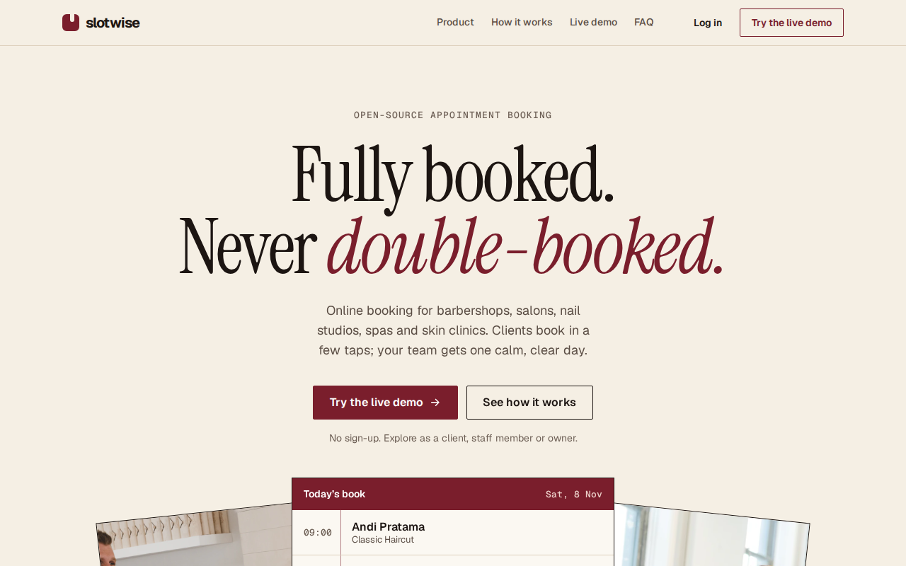
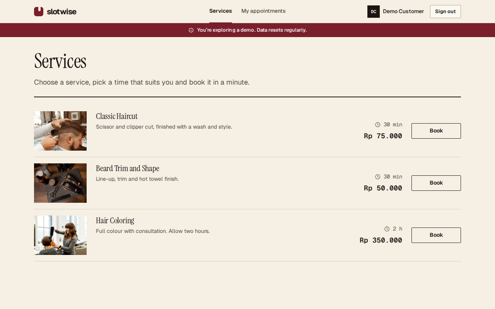
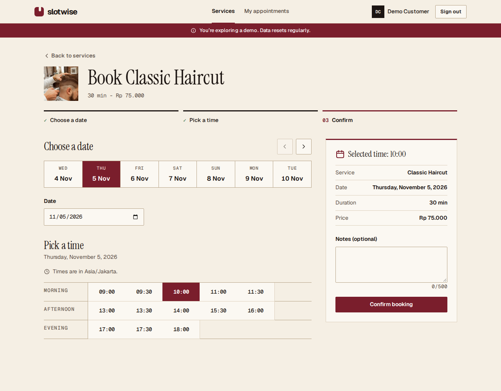
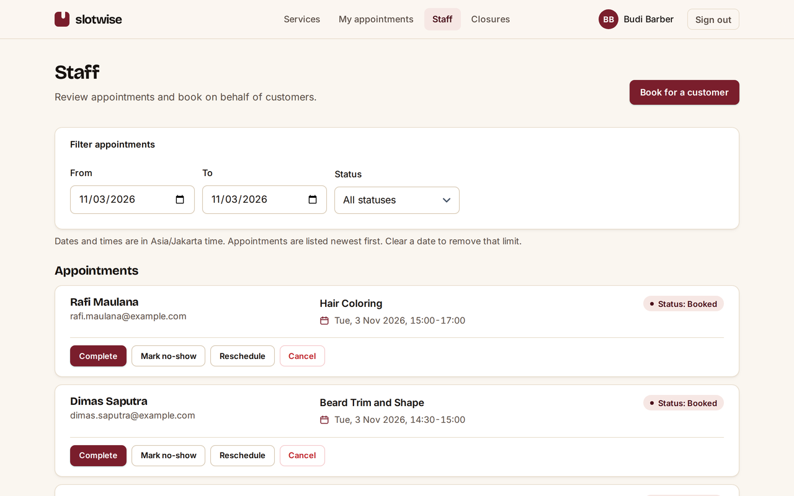
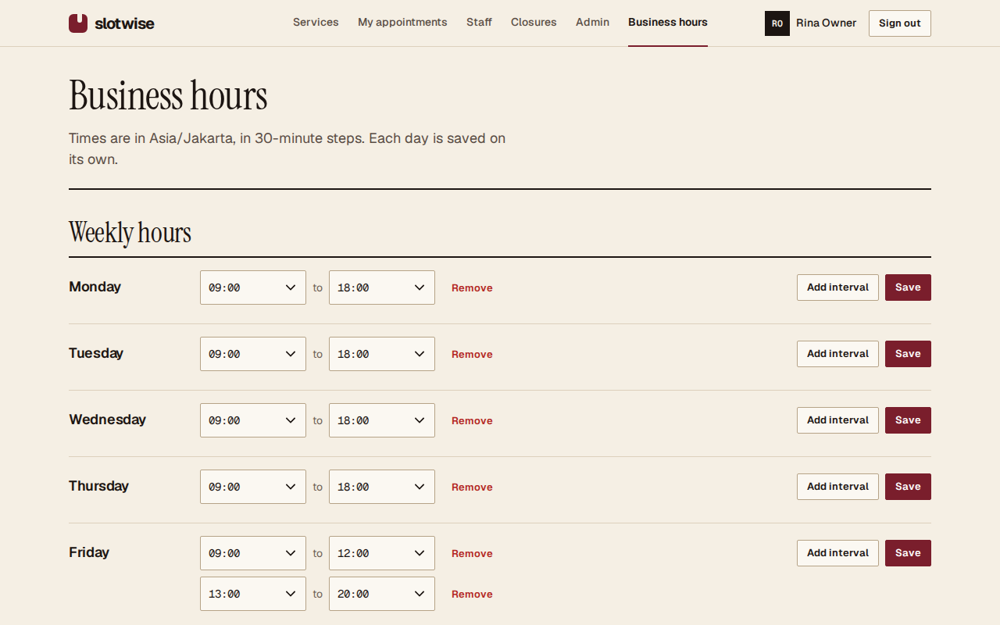

<div align="center">


# Slotwise

**Online booking for barbershops, salons and studios. Fully booked, never double-booked.**

[Live demo](https://slotwise-mocha.vercel.app) · [Features](#features) · [Screenshots](#screenshots) · [Run it locally](#run-it-locally)




</div>

## About

Slotwise gives a small appointment-based business two things: a booking page clients can use
in a minute on their phone, and one shared calendar the whole team can trust. The database
itself refuses overlapping appointments, so two clients can never end up in the same slot,
even when they tap at the same moment.

It is a full-stack project: a React and TypeScript single-page app on top of a FastAPI and
PostgreSQL API, both covered by automated tests.

## Try the live demo

The demo runs a fictional Jakarta barbershop with three weeks of history and two weeks of
upcoming bookings. Sign in with one click from the [landing page](https://slotwise-mocha.vercel.app),
or type a login:

| Role | Email | Password | What you can do |
|---|---|---|---|
| Client | `demo.customer@example.com` | `demo-customer-2026` | Book a service, then cancel or reschedule it; see past visits |
| Staff | `staff@barbershop.example` | `demo-staff-2026` | Run the day's list, book walk-ins, mark visits completed or no-show, add closures |
| Owner | `admin@barbershop.example` | `demo-admin-2026` | Everything staff can do, plus services, prices and weekly opening hours |

> [!NOTE]
> The accounts are shared and the data resets regularly, so change whatever you like. The API
> runs on a free plan that sleeps when idle; the first request can take up to a minute.

## Features

**For clients**
- Services with photos, prices in rupiah and durations
- Real open times on a 30-minute grid, in the shop's time zone
- Cancel or reschedule online up to 24 hours before
- Delete their own account at any time

**For staff**
- Appointments by date and status
- Book on behalf of a client, for walk-ins and phone bookings
- Mark visits completed or no-show once they start
- Block closures for holidays or training

**For owners**
- Add, edit, pause and reactivate services
- Opening hours per weekday, split around a lunch break if needed
- Changes that would strand an existing booking are refused

## Screenshots

<table>
  <tr>
    <td width="50%"><br><sub>Services</sub></td>
    <td width="50%"><br><sub>Booking</sub></td>
  </tr>
  <tr>
    <td width="50%"><br><sub>Staff dashboard</sub></td>
    <td width="50%"><br><sub>Business hours</sub></td>
  </tr>
</table>

## How it's built

| Layer | Stack |
|---|---|
| Frontend | React 19, TypeScript, Vite, React Router, Motion, plain CSS on design tokens |
| Backend | Python, FastAPI, SQLAlchemy 2, Alembic |
| Database | PostgreSQL |
| Tests | Pytest against a real Postgres; Vitest and Testing Library |
| Hosting | Vercel (frontend) and Render (API and database) |

A few decisions worth a look:

- **No double booking by design.** A PostgreSQL exclusion constraint rejects any two active
  appointments whose times overlap, and Postgres advisory locks order bookings against changes
  to hours and closures.
- **Sessions done properly.** Server-side sessions with hashed tokens, argon2id passwords, a
  CSRF token held only in memory, an Origin check on every write, and login throttling per
  email and per IP.
- **A demo that stays fresh.** Seed data is generated relative to today and rebuilt on every
  cold start, and the shared demo accounts are protected from lockouts and takeovers.
- **Accessible and responsive.** Labelled controls, visible focus, keyboard support, live
  regions for status messages, reduced-motion support, and layouts down to 375px.

The data model is in [docs/erd.md](docs/erd.md); deployment and maintenance are in
[docs/operations.md](docs/operations.md).

## Run it locally

You need Python 3.12, Node.js 20.19 or later, and Docker.

```bash
git clone https://github.com/hal-imaxabdi/slotwise.git
cd slotwise
cp .env.example .env              # then set a real POSTGRES_PASSWORD and DATABASE_URL
docker compose up -d db
```

**API** (in `backend/`):

```bash
python -m venv .venv && source .venv/bin/activate
pip install -r requirements.txt
alembic upgrade head
DEMO_MODE=true python -m scripts.reset_demo   # fills the database with the demo shop
DEMO_MODE=true uvicorn app.main:app --reload
```

**Web app** (in `frontend/`, in a second terminal):

```bash
npm install
npm run dev                        # http://localhost:5173
```

**Tests:**

```bash
cd backend && pytest
cd frontend && npm run typecheck && npm run lint && npm test
```

## Credits

Photos from [Unsplash](https://unsplash.com/license), used under the Unsplash License.
Fonts: Instrument Serif, Geist and Geist Mono, under the SIL Open Font
License (licence files in `frontend/public/fonts`). The barbershop and everyone in the demo
are fictional.
