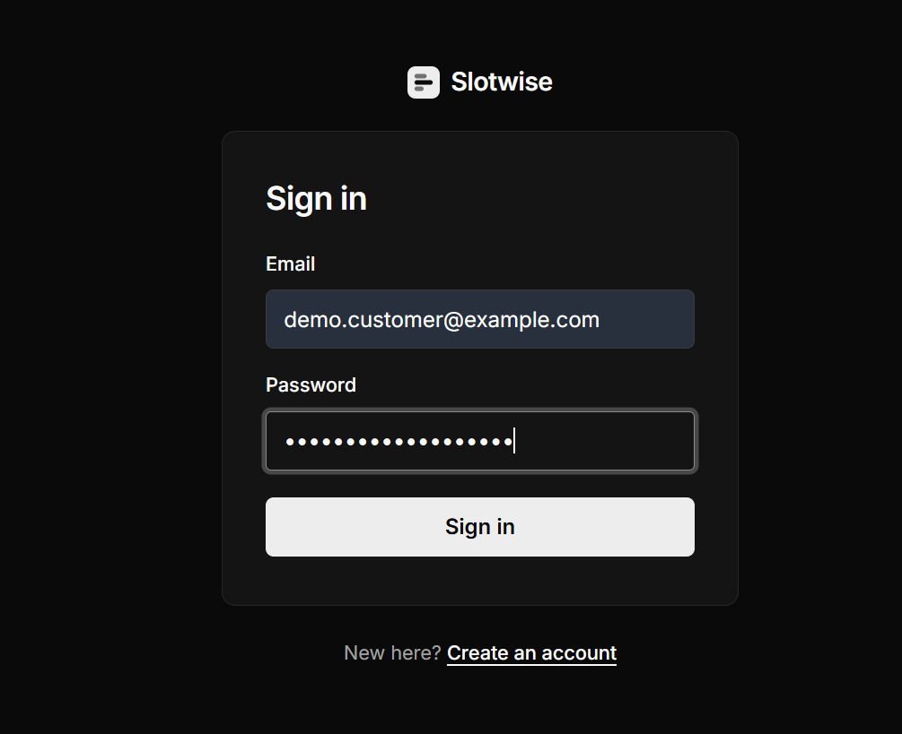
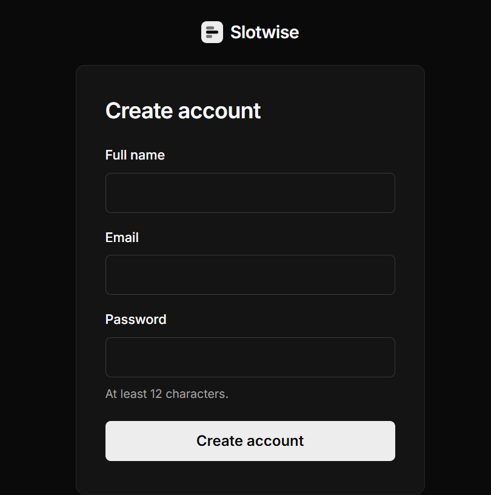
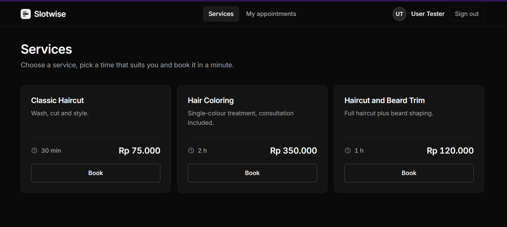
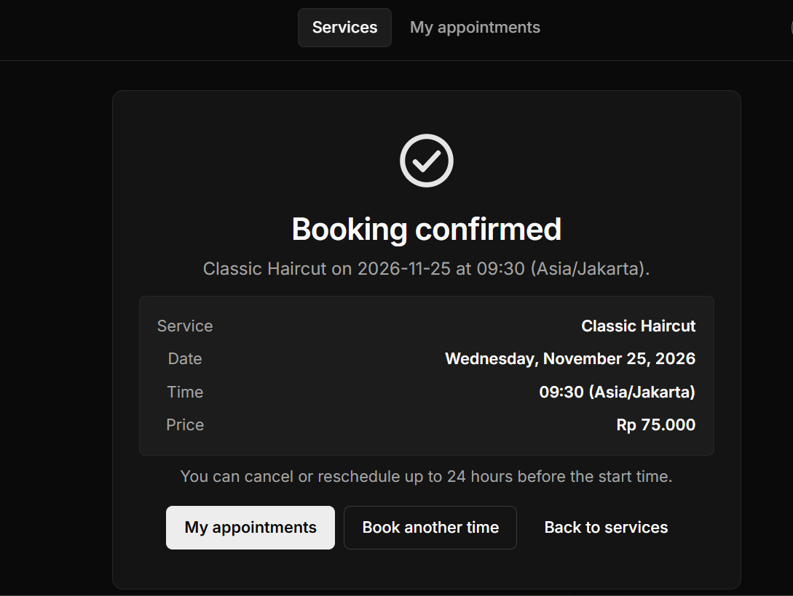
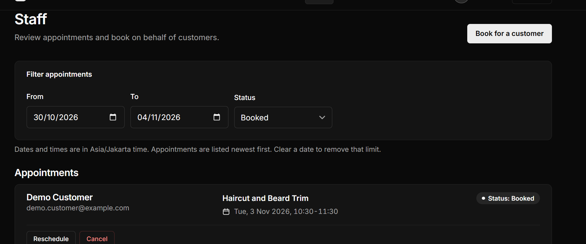
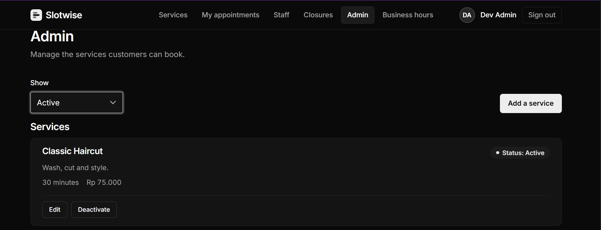

# Slotwise — Appointment Booking System

**Making appointment scheduling simpler for businesses and their customers.**

A full-stack appointment booking platform built with React, FastAPI, and PostgreSQL. Customers can discover services, find available time slots, and manage appointments, while staff and administrators manage bookings and business schedules.

#### [Features](#features) · [Getting Started](#getting-started) · [Tech Stack](#tech-stack) · [Preview](#preview) · [Live demo](https://slotwise-mocha.vercel.app)

---

## Features

- **Customer Authentication:** Registration, login, and secure session management.
- **Service Browsing:** Explore available services offered by the business.
- **Appointment Booking:** Check available time slots and book appointments.
- **Appointment Management:** View, cancel, and reschedule bookings.
- **Staff Dashboard:** Manage appointments, search customers, and update appointment statuses.
- **Admin Dashboard:** Create, update, activate, and deactivate services.
- **Business Hours Management:** Configure weekly operating hours.
- **Unavailable Periods:** Manage business closures and unavailable time slots.
- **Security:** CSRF protection, origin validation, and session-based authentication.

## Getting Started

### Installation

1. **Clone this repository**

   ```bash
   git clone https://github.com/hal-imaxabdi/slotwise.git
   cd slotwise
   ```

2. **Configure the database**

   Create a `.env` file in the project root with the required environment variables and PostgreSQL credentials.

   Start the database using Docker Compose:

   ```bash
   docker compose up -d db
   ```

3. **Start the backend**

   ```bash
   cd backend
   python -m venv .venv
   source .venv/bin/activate
   pip install -r requirements.txt
   alembic upgrade head
   uvicorn app.main:app --reload
   ```

4. **Start the frontend**

   Open another terminal:

   ```bash
   cd frontend
   npm install
   npm run dev
   ```

## Tech Stack

- **Frontend:** React, TypeScript, Vite
- **Backend:** Python, FastAPI
- **Database:** PostgreSQL
- **ORM:** SQLAlchemy
- **Database Migrations:** Alembic
- **Testing:** Pytest
- **Containerization:** Docker Compose

## Preview

<table>
  <tr>
    <td align="center">
      <strong>Login</strong><br><br>
      
    </td>
    <td align="center">
      <strong>Registration</strong><br><br>
      
    </td>
  </tr>
  <tr>
    <td align="center">
      <strong>Customer Dashboard</strong><br><br>
      
    </td>
    <td align="center">
      <strong>Appointment Booking</strong><br><br>
      
    </td>
  </tr>
  <tr>
    <td align="center">
      <strong>Staff Dashboard</strong><br><br>
      
    </td>
    <td align="center">
      <strong>Admin Dashboard</strong><br><br>
      
    </td>
  </tr>
</table>

