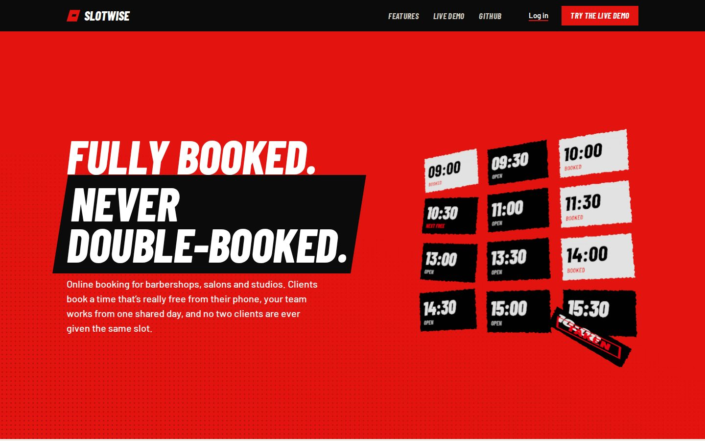
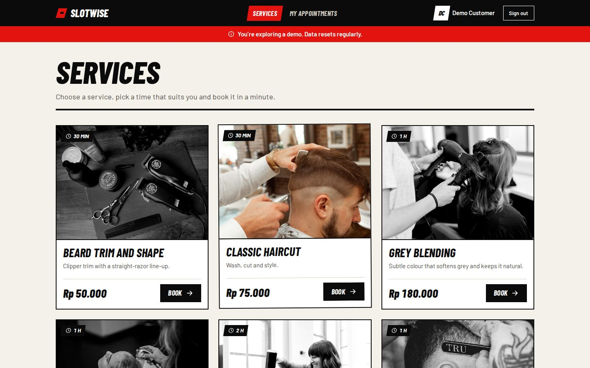
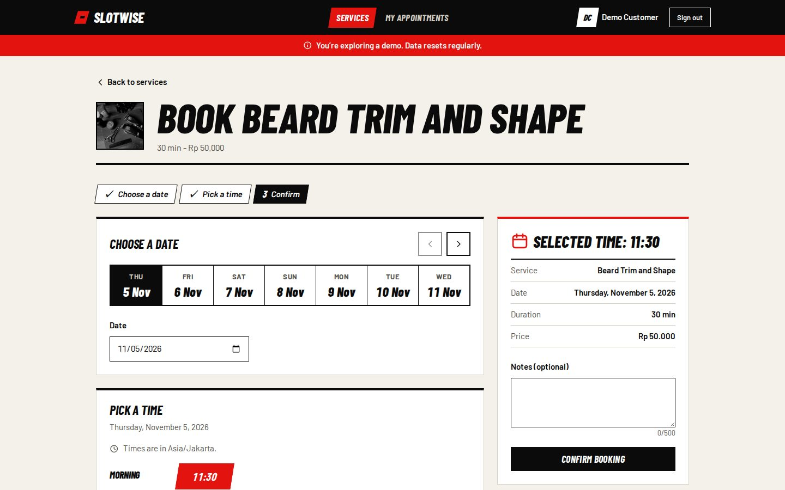
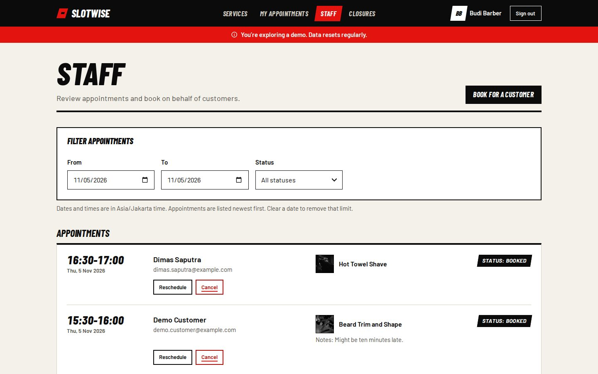

<div align="center">


# Slotwise

**Appointment booking for barbershops, salons and studios.**<br>
Fully booked. Never double-booked.

<br>


<br>

[](https://slotwise-mocha.vercel.app)

<br><br>



</div>

<br>

## Overview

Slotwise is a full-stack booking platform for small appointment-based businesses. Clients book
from their phone in under a minute, and the whole team works from one shared calendar. Every
booking is checked by the database itself, so two clients can never be given the same time slot.

## Live demo

**Try the live demo** to sign in instantly; no account is needed.
<table>
  <tr>
    <td width="33%"><br><sub><b>Services</b></sub></td>
    <td width="33%"><br><sub><b>Booking</b></sub></td>
    <td width="33%"><br><sub><b>Staff view</b></sub></td>
  </tr>
</table>

> [!NOTE]
> Demo data resets regularly. The server sleeps when idle, so the first request may take up to a minute.

## Key features

- **Conflict-free scheduling.** Overlapping bookings are rejected at the database level, even under simultaneous requests.
- **Live availability.** Only genuinely free slots are offered, based on opening hours, closures and existing bookings.
- **Self-service for clients.** Bookings can be rescheduled or cancelled online up to 24 hours in advance.
- **Tools for the team.** Staff handle walk-ins and visit outcomes; owners manage services, pricing and hours without disrupting existing bookings.
- **Secure by default.** Server-side sessions, hashed passwords, CSRF protection and login throttling. Clients can delete their account at any time.
- **Responsive and accessible.** Built mobile-first, with keyboard support and reduced-motion handling.

## Getting started

**Prerequisites:** Python 3.12, Node.js 20.19+ and Docker. Copy `.env.example` to `.env` and set the
database credentials.

```bash
docker compose up -d db

# API (backend/)
pip install -r requirements.txt
alembic upgrade head
DEMO_MODE=true python -m scripts.reset_demo
DEMO_MODE=true uvicorn app.main:app --reload

# Web app (frontend/)
npm install
npm run dev
```

## Project structure

```
backend/    FastAPI application, database migrations and tests
frontend/   React web application and tests
docs/       Design system, data model and operations notes
```


